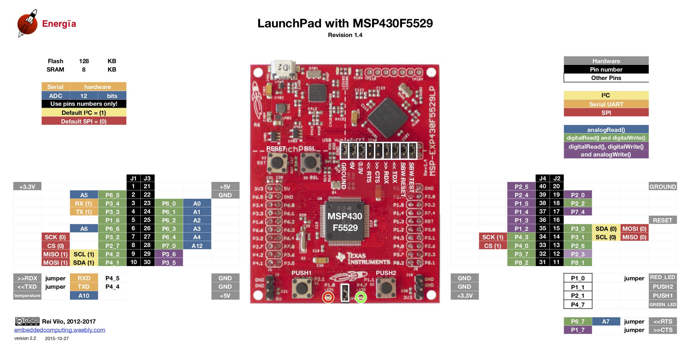
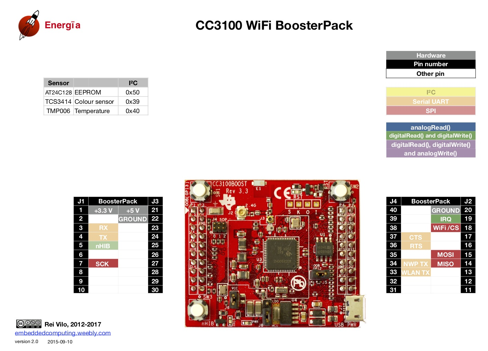
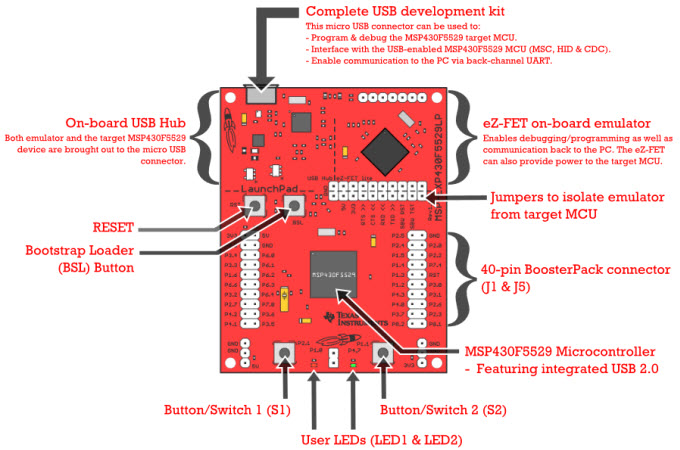

# TI MSP430

## TI hardware

Following boards are available to you:  
[MSP-EXP430F5529LP](https://www.ti.com/tool/MSP-EXP430F5529LP) - Main LaunchPad board  
[CC3100BOOST](https://www.ti.com/tool/CC3100BOOST) - WiFi plug-on board  

It's enough to put power cable only into the MSP430F5529 board. The wifi will be powered from it.

### Launchpad pinout



### CC3100 BoosterPack pinout



### Board overview (reset button location)



## TI software

### PlatformIO

Use [PlatformIO](https://platformio.org/) (VS Code extension or the `pio` CLI).  
It supports the LaunchPad with the Arduino framework, so Arduino-style code and libraries (`WiFi`, `SPI`, `Wire`, `Servo`, ...) work.

Board docs: https://docs.platformio.org/en/latest/boards/timsp430/lpmsp430f5529.html

`platformio.ini`:

```ini
[env:lpmsp430f5529]
platform = timsp430
board = lpmsp430f5529
framework = arduino
monitor_speed = 9600
```

When you connect the board to your computer it should create 2 COM ports.  
One is marked as MSP Application and the other as MSP Debug.  
The Debug port is used to upload your code to the LaunchPad board. Serial monitor works on the Application port.

### Wi-Fi test

Ready-made project: [msp430_wifi_test/](msp430_wifi_test/)  
It connects to the `hackathon` Wi-Fi and prints the IP address, signal strength and MAC address of the board.

```sh
cd msp430_wifi_test
pio run -t upload       # build and flash
pio device monitor      # open serial monitor, then press the reset button
```

If you're adapting Arduino code: Arduino has a 10 bit ADC (0-1023), the MSP430F5529 ADC is 12 bit (0-4095).

## Online API sidenote

- ThingSpeak  
  <https://thingspeak.com/>  
  <https://www.mathworks.com/help/thingspeak/rest-api.html>
